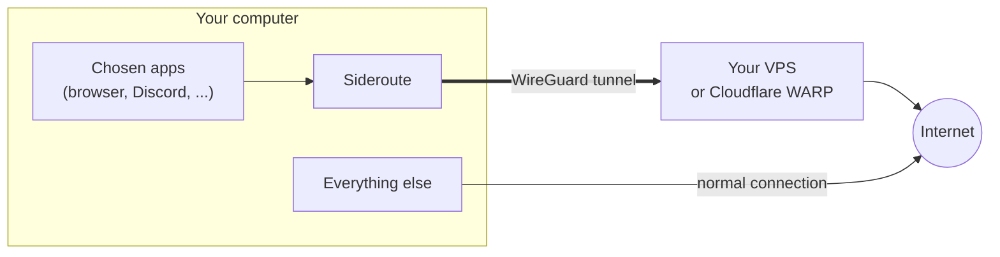

<p align="center">
  
</p>

<h1 align="center">Sideroute</h1>

<p align="center">
  <b>Per-app VPN for Windows and Linux.</b><br>
  Send just the apps you choose through a tunnel, while they keep running. Everything else stays on
  your normal connection.
</p>

<p align="center">
  <a href="https://github.com/attaberuku/sideroute/releases/latest"></a>
  <a href="https://github.com/attaberuku/sideroute/actions/workflows/ci.yml"></a>
  
  
</p>

<p align="center"><a href="README.tr.md">Türkçe</a> · <a href="#quick-start">Quick start</a> · <a href="#faq">FAQ</a> · <a href="docs/PROTOCOL.md">Protocol</a></p>

---

Your browser should go through a VPN, but your games, downloads and video calls should not? A normal
VPN is all or nothing. **Sideroute works per app**: press a key in a program and from then on only
that program's traffic goes through the tunnel. Press it again and it connects directly again. The
program keeps running.

The tunnel can end at:

- **Cloudflare WARP:** free, nothing to set up. Just press Enter during installation.
- **Your own server:** any cheap VPS, one command to install. Your traffic only ever passes through
  a machine you control.

## Features

- **Per app, live.** Running apps move into the tunnel and back without restarting. Their open
  connections are closed, so they reconnect through the new route within a second.
- **One-step setup.** On Windows a regular installer. On Linux and on the server, one command each,
  plus one pairing code (or none with WARP).
- **No leaks.**
  - A kill switch: if the tunnel drops, tunneled apps go offline instead of going around it.
  - IPv6 is blocked for tunneled apps.
  - LAN addresses (printers, NAS) stay local.
- **Secure pairing.** Keys are generated on your device, the private key never leaves it, and the
  pairing code pins the server's certificate.
- **Fits in.** A notification-area icon and a hotkey on Windows. A window-menu entry and a hotkey on
  KDE Plasma. A command line everywhere.
- **Small and open.** Written in Rust, built on WireGuard, dual-licensed MIT / Apache-2.0.

## Quick start

| | |
|---|---|
| **Windows 10/11** | Download **[SiderouteSetup.exe](https://github.com/attaberuku/sideroute/releases/latest)** and run it. Choose *Cloudflare WARP* or paste your server's code, then *Install*. |
| **Linux** | `curl -fsSL https://raw.githubusercontent.com/attaberuku/sideroute/main/client/install.sh \| bash` <br>Press Enter for WARP, or paste your server's code. |
| **Own server** (optional) | On a Debian/Ubuntu VPS: `curl -fsSL https://raw.githubusercontent.com/attaberuku/sideroute/main/server/install.sh \| sudo bash` <br>It prints the pairing code (and a QR code). |

Then:

- **Windows:** press **`Ctrl+Alt+V`** in a program, or use the tray icon's menu → *Route a running
  program*.
- **KDE Plasma:** press **`Meta+Alt+V`**, or right-click the title bar → *Route through Sideroute*.
- **Linux, any desktop:** `sideroute toggle firefox`.

To check that it works, open https://www.cloudflare.com/cdn-cgi/trace in a tunneled browser. With
WARP it shows `warp=on`; with your own server, `ip=` shows the server's address.

## How it works



- **Linux.** The app's whole process tree is moved into its own systemd slice (no root needed, and
  the app keeps running). nftables marks connections from that slice, and the mark selects a routing
  table whose only routes are the WireGuard interface and an `unreachable` fallback (the kill
  switch). DNS that the app sends itself is redirected into the tunnel.
- **Windows.**
  - A WireGuard adapter (wireguard-nt) carries the tunnel.
  - ProxiFyre redirects the chosen programs to a small SOCKS5 server inside Sideroute.
  - That server sends their connections out pinned to the tunnel adapter. Nothing else on the
    system uses the adapter.
- **Pairing.** The server's one-time code carries its address, a secret and its TLS certificate
  fingerprint. The client sends only its WireGuard public key and gets back the tunnel settings.
  Details are in [docs/PROTOCOL.md](docs/PROTOCOL.md). WARP mode registers a device through
  Cloudflare's own API instead, so the WARP app is not needed.

## WARP or your own server?

| | Cloudflare WARP | Own server (VPS) |
|---|---|---|
| Cost | free | a VPS, a few €/month |
| Setup | none | one command on the server |
| Exit location | nearby Cloudflare location, shared IPs | your VPS's country, its own IP |
| Who carries your traffic | Cloudflare | you (and your VPS provider) |
| Can be blocked by networks | sometimes | rarely |

You can switch any time:

- **Windows:** use the tray menu (*Use Cloudflare WARP* / *Pair with my server*).
- **Linux:** run `sideroute pair`.

## Using it

### Windows

- **Ctrl+Alt+V** moves the program of the active window into the tunnel, or back. A notification
  confirms it.
- **Tray icon:** grey when idle, green while programs are tunneled, amber when the tunnel has a
  problem. Its tooltip lists the tunneled programs.
- **Menu:**
  - the status line and traffic;
  - the programs in the tunnel (click one to remove it);
  - *Route a running program*;
  - WARP or pairing (copy the server's code, then choose *Pair with my server*);
  - *Troubleshooting report*;
  - *Quit*. Quitting switches every program back to direct.
- Programs are chosen **by executable name**. Every window of that program, and any helper programs
  it started, go through the tunnel. The choice is kept after a restart.
- **Uninstall:** Settings → Apps → Sideroute.

For unattended installs: `SiderouteSetup.exe setup --quiet [--warp | --code CODE] [--no-autostart]`.

### Linux

```bash
sideroute toggle firefox      # by process name or PID; again to switch back
sideroute run discord         # start a program directly inside the tunnel
sideroute status              # tunnel state and which apps are in it
sideroute off                 # switch every app back and stop the tunnel
sideroute pair                # pair with a server, or press Enter for WARP
```

Requirements: systemd and cgroup v2 (any current distribution), x86_64 or aarch64. KDE Plasma 6 gets
the window-menu entry and the `Meta+Alt+V` shortcut (System Settings → Shortcuts → KWin to change it).

### Your server

```bash
sudo sideroute-server pair            # new pairing code (--name LABEL, --ttl MINUTES)
sudo sideroute-server list            # paired devices and when they were last seen
sudo sideroute-server revoke laptop   # by name, tunnel address or public key
sudo sideroute-server status
```

- **Requirements:**
  - Debian 11+ or Ubuntu 20.04+ on a KVM VPS (OpenVZ/LXC containers cannot run WireGuard).
  - A public IPv4 address.
  - **UDP 51820** and **TCP 51821** open in the provider's firewall.
- You can run the installer again safely: it upgrades and keeps your devices.
- It adds its own WireGuard interface and firewall rules, and does not touch existing WireGuard,
  Docker or Tailscale setups.

## FAQ

**Do apps have to be restarted?**
No. Their open connections are closed once, and they reconnect through the new route right away. A
running download or call may restart.

**Does it slow things down?**
Only the tunneled apps take the longer path through the server or WARP. WireGuard itself adds very
little. Everything else is untouched.

**Do I need a server?**
No. WARP works without one. Your own server gives you a fixed exit country and keeps your traffic
away from third parties.

**What can Cloudflare or my VPS provider see?**
Whoever runs the far end of the tunnel can see which addresses tunneled apps talk to, just as your
internet provider otherwise would. HTTPS still protects the content.

**My antivirus or Google Drive says the installer is a virus.**
That is a false positive. The installer is not code-signed yet, it contains another installer
(ProxiFyre), and it installs a driver: this pattern resembles malware to heuristic scanners. The
source is all here, and releases are built by GitHub Actions from it. Code signing is planned.

**Does it work with GoodbyeDPI or zapret?**
Close them while you use Sideroute. They rewrite network packets and break connections through the
tunnel, and the tunnel already hides traffic from DPI. Sideroute warns you when it finds them
running.

**Does it work with another VPN running?**
A VPN that captures all traffic on the same computer has not been tested together with Sideroute.

## Troubleshooting

- **Windows:** tray icon → *Troubleshooting report*. It opens a text report with three test requests
  (directly through the tunnel, through Sideroute's proxy, and without the tunnel), checks whether
  any connection of a tunneled program bypasses the tunnel, and includes the logs. Attach it when
  you open an issue; your own IP address is masked in it.
- **Linux:** `sideroute status`; the helper's messages are in `journalctl --user -u sideroute`.
- **An app does not load after being moved:** quit it completely (also from the notification area)
  and start it again while it is in the list.

## Security and privacy

- **Keys.**
  - Each device generates its own WireGuard key pair, and only the public key is sent.
  - On Linux, the private key is readable by root only (`/etc/sideroute`, mode `0600`).
  - On Windows, it is readable by SYSTEM and Administrators only (`%ProgramData%\Sideroute`).
- **Pairing.**
  - The code pins the server's self-signed TLS certificate, so nobody in between can substitute
    another server.
  - The 100-bit secret works once and expires after 15 minutes.
  - The server stores only its hash, and failed attempts are slowed down and rate-limited.
- **Privileges.**
  - On Linux, `sideroute-helper` does the root-only network setup. A sudoers rule allows only its
    `up`, `down`, `status` and `kill-sockets` commands without a password, and pairing asks for the
    password.
  - The helper validates everything it receives: server values before they reach `wg`/`ip`/`nft`,
    and process IDs must belong to the calling user.
  - On Windows, the tray app runs elevated through a scheduled task.
- **Kill switch.**
  - Tunneled traffic can only leave through the tunnel.
  - On Windows, if Sideroute stops unexpectedly, the chosen programs stay offline. *Quit* switches
    them back to direct.
- **DNS.**
  - On Linux, DNS queries a tunneled app sends itself go through the tunnel.
  - Lookups the operating system makes on an app's behalf use your normal DNS: on Windows always, on
    Linux with `nss-resolve`. The connections themselves still go through the tunnel. If that
    matters to you, enable DNS-over-HTTPS in the app.
- **Server isolation.** Tunnel clients cannot reach the server's private networks (Docker, Tailscale,
  cloud metadata) or each other.
- **Local proxy.** On Windows, Sideroute's SOCKS5 proxy listens on `127.0.0.1:40871` without a
  password. Other programs on the same computer could use it too.
- **WARP.** WARP is Cloudflare's consumer service. Its [terms](https://www.cloudflare.com/application/terms/)
  apply, and its API can change.

Found a vulnerability? Please report it privately; see [SECURITY.md](SECURITY.md).

## Status and roadmap

Sideroute is young (v0.1).

**Tested:**

- The server and the Linux client, end to end in network namespaces.
- The Linux client live against Cloudflare WARP.
- The Windows client with WARP on a real machine, with browsers and Discord.

**Planned:**

- Code-signed Windows builds.
- DNS through the tunnel on Windows.
- IPv6 inside the tunnel.
- A GNOME integration.
- Arm64 Windows builds.

Ideas and pull requests are welcome.

## Building

```bash
cargo build --release
cargo test
tests/e2e-netns.sh          # server + Linux client in network namespaces, no root needed
tests/warp-live.sh          # Linux client against real Cloudflare WARP (needs internet)
scripts/build-windows.sh    # SiderouteSetup.exe, cross-built on Linux (clang + lld + llvm-mingw)
```

`tests/e2e-netns.sh` checks:

- pairing, including a wrong certificate and a reused code;
- that only the tunneled cgroup uses the tunnel;
- DNS redirection, socket closing and the kill switch;
- revocation and clean removal of all firewall rules.

To build the Windows client on Windows:

1. Run `scripts/fetch-windows-payload.sh` in Git Bash. It downloads the pinned `wireguard.dll` and
   ProxiFyre setup.
2. Set `SIDEROUTE_PAYLOAD_DIR` to its output.
3. Run `cargo build --release -p sideroute-windows`.

| Path | What |
|---|---|
| `crates/proto` | pairing code, API types, WARP request/response |
| `crates/net` | client HTTPS calls (pairing, WARP) |
| `crates/server` | `sideroute-server` |
| `crates/client` | Linux: `sideroute`, `sideroute-helper` |
| `crates/windows` | `Sideroute.exe`: setup wizard and tray app |
| `client/`, `server/`, `windows/` | installers, KWin script, systemd units, icons |
| `docs/PROTOCOL.md` | the pairing protocol (for other clients) |

## Third-party components

| Component | Used for | License |
|---|---|---|
| [WireGuard](https://www.wireguard.com/) (kernel / `wireguard-tools`) | tunnel on Linux and the server | GPL-2.0, from your distribution |
| [wireguard-nt](https://git.zx2c4.com/wireguard-nt/about/) (`wireguard.dll`) | tunnel on Windows | prebuilt-binaries license, bundled unmodified |
| [ProxiFyre](https://github.com/wiresock/proxifyre) | per-program redirection on Windows | AGPL-3.0, separate program, its installer bundled unmodified |
| [Windows Packet Filter](https://github.com/wiresock/ndisapi) | driver used by ProxiFyre | MIT |

## License

Sideroute is dual-licensed under [MIT](LICENSE-MIT) or [Apache-2.0](LICENSE-APACHE), at your option.
