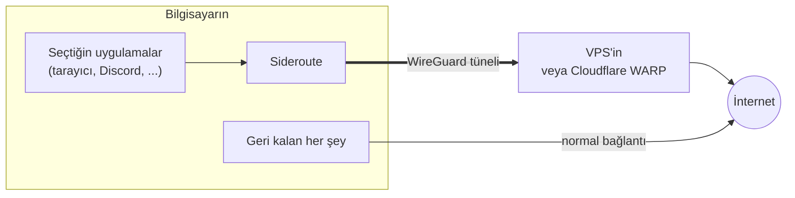

<p align="center">
  
</p>

<h1 align="center">Sideroute</h1>

<p align="center">
  <b>Windows ve Linux için uygulama bazlı VPN.</b><br>
  Yalnızca seçtiğin uygulamaları, onları kapatmadan tünelden geçir. Geri kalan her şey normal
  bağlantında kalır.
</p>

<p align="center">
  <a href="https://github.com/attaberuku/sideroute/releases/latest"></a>
  <a href="https://github.com/attaberuku/sideroute/actions/workflows/ci.yml"></a>
  
  
</p>

<p align="center"><a href="README.md">English</a> · <a href="#hızlı-başlangıç">Hızlı başlangıç</a> · <a href="#sss">SSS</a> · <a href="docs/PROTOCOL.md">Protokol</a></p>

---

Tarayıcın VPN'den geçsin ama oyunların, indirmelerin ve görüntülü aramaların geçmesin mi? Normal bir
VPN ya hep ya hiç çalışır. **Sideroute uygulama bazında çalışır**: bir programdayken bir tuşa
basarsın, o andan itibaren yalnızca o programın trafiği tünelden geçer. Tekrar basınca yeniden
doğrudan bağlanır. Program bu sırada çalışmaya devam eder.

Tünelin çıkış noktası iki yerden biri olabilir:

- **Cloudflare WARP:** ücretsiz, hiçbir ayar gerekmez. Kurulumda sadece Enter'a basarsın.
- **Kendi sunucun:** herhangi bir ucuz VPS, tek komutla kurulur. Trafiğin yalnızca senin kontrol
  ettiğin makineden geçer.

## Özellikler

- **Uygulama bazında, canlı.** Çalışan uygulamalar yeniden başlatılmadan tünele girer ve çıkar.
  Açık bağlantıları kapatılır, böylece bir saniye içinde yeni yoldan yeniden bağlanırlar.
- **Tek adımda kurulum.** Windows'ta sıradan bir kurulum programı. Linux'ta ve sunucuda tek komut,
  artı bir eşleştirme kodu (WARP'ta o da yok).
- **Sızıntı yok.**
  - Kill switch var: tünel düşerse tüneldeki uygulamalar başka yoldan çıkmak yerine çevrimdışı
    kalır.
  - Tüneldeki uygulamalar için IPv6 engellenir.
  - Yerel ağ adresleri (yazıcı, NAS) yerelde kalır.
- **Güvenli eşleştirme.** Anahtarlar cihazında üretilir, özel anahtar cihazdan hiç çıkmaz.
  Eşleştirme kodu sunucunun sertifikasını sabitler.
- **Sistemine uyar.** Windows'ta bildirim alanı simgesi ve kısayol. KDE Plasma'da pencere menüsü
  girdisi ve kısayol. Her yerde komut satırı.
- **Küçük ve açık.** Rust ile yazıldı, WireGuard üzerine kurulu, MIT / Apache-2.0 çift lisanslı.

## Hızlı başlangıç

| | |
|---|---|
| **Windows 10/11** | **[SiderouteSetup.exe](https://github.com/attaberuku/sideroute/releases/latest)**'yi indir ve çalıştır. *Cloudflare WARP*'ı seç ya da sunucunun kodunu yapıştır, sonra *Kur*. |
| **Linux** | `curl -fsSL https://raw.githubusercontent.com/attaberuku/sideroute/main/client/install.sh \| bash` <br>WARP için Enter'a bas ya da sunucunun kodunu yapıştır. |
| **Kendi sunucun** (isteğe bağlı) | Debian/Ubuntu bir VPS'te: `curl -fsSL https://raw.githubusercontent.com/attaberuku/sideroute/main/server/install.sh \| sudo bash` <br>Eşleştirme kodunu (ve QR kodunu) yazdırır. |

Sonra:

- **Windows:** bir programdayken **`Ctrl+Alt+V`**'ye bas ya da simgenin menüsünden *Çalışan bir
  programı tünele al*'ı seç.
- **KDE Plasma:** **`Meta+Alt+V`**'ye bas ya da başlık çubuğuna sağ tıkla → *Route through
  Sideroute*.
- **Herhangi bir Linux masaüstü:** `sideroute toggle firefox`.

Çalıştığını kontrol etmek için tüneldeki bir tarayıcıda https://www.cloudflare.com/cdn-cgi/trace
adresini aç. WARP'ta `warp=on` yazar; kendi sunucunda `ip=` sunucunun adresini gösterir.

## Nasıl çalışır



- **Linux.** Uygulamanın tüm süreç ağacı kendi systemd slice'ına taşınır; root gerekmez ve uygulama
  çalışmaya devam eder. nftables bu slice'tan çıkan bağlantıları işaretler. İşaret, tek rotası
  WireGuard arayüzü ve bir `unreachable` yedeği (kill switch) olan bir yönlendirme tablosunu seçer.
  Uygulamanın kendi gönderdiği DNS sorguları da tünele yönlendirilir.
- **Windows.**
  - Tüneli bir WireGuard bağdaştırıcısı (wireguard-nt) taşır.
  - ProxiFyre, seçilen programları Sideroute içindeki küçük bir SOCKS5 sunucusuna yönlendirir.
  - Bu sunucu bağlantıları yalnızca tünel bağdaştırıcısından dışarı çıkarır. Sistemde başka hiçbir
    şey bu bağdaştırıcıyı kullanmaz.
- **Eşleştirme.** Sunucunun tek kullanımlık kodu adresini, bir gizli değeri ve TLS sertifikasının
  parmak izini taşır. İstemci yalnızca WireGuard açık anahtarını gönderir ve tünel ayarlarını
  alır. Ayrıntılar [docs/PROTOCOL.md](docs/PROTOCOL.md)'de. WARP modunda ise Cloudflare'in kendi
  API'si üzerinden cihaz kaydı yapılır; WARP uygulamasına gerek kalmaz.

## WARP mı, kendi sunucun mu?

| | Cloudflare WARP | Kendi sunucun (VPS) |
|---|---|---|
| Ücret | ücretsiz | bir VPS, ayda birkaç € |
| Kurulum | yok | sunucuda tek komut |
| Çıkış konumu | yakındaki bir Cloudflare noktası, ortak IP'ler | VPS'inin ülkesi, kendi IP'si |
| Trafiğini kim taşır | Cloudflare | sen (ve VPS sağlayıcın) |
| Ağlar engelleyebilir mi | bazen | nadiren |

İstediğin zaman geçiş yapabilirsin:

- **Windows:** simge menüsünden *Cloudflare WARP kullan* ya da *Sunucumla eşleştir*.
- **Linux:** `sideroute pair`.

## Kullanım

### Windows

- **Ctrl+Alt+V**, etkin penceredeki programı tünele alır ya da geri çıkarır. Bir bildirim bunu
  onaylar.
- **Simge:** boştayken gri, tünelde program varken yeşil, tünelde sorun varken turuncu. Üzerine
  gelince tüneldeki programları listeler.
- **Menü:**
  - durum satırı ve trafik;
  - tüneldeki programlar (çıkarmak için tıkla);
  - *Çalışan bir programı tünele al*;
  - WARP veya eşleştirme (sunucunun kodunu kopyala, sonra *Sunucumla eşleştir*);
  - *Sorun giderme raporu*;
  - *Çık*. Çıkınca tüm programlar doğrudan bağlantıya döner.
- Programlar **çalıştırılabilir dosya adıyla** seçilir. O programın tüm pencereleri ve başlattığı
  yardımcı programlar tünelden geçer. Seçim yeniden başlatmadan sonra da korunur.
- **Kaldırma:** Ayarlar → Uygulamalar → Sideroute.

Gözetimsiz kurulum için: `SiderouteSetup.exe setup --quiet [--warp | --code KOD] [--no-autostart]`.

### Linux

```bash
sideroute toggle firefox      # süreç adı veya PID ile; geri almak için tekrar
sideroute run discord         # bir programı doğrudan tünelin içinde başlat
sideroute status              # tünel durumu ve içindeki uygulamalar
sideroute off                 # tüm uygulamaları geri al ve tüneli kapat
sideroute pair                # bir sunucuyla eşleştir ya da WARP için Enter
```

Gereksinimler: systemd ve cgroup v2 (güncel tüm dağıtımlarda var), x86_64 veya aarch64. KDE Plasma
6'da pencere menüsü girdisi ve `Meta+Alt+V` kısayolu gelir. Kısayolu Sistem Ayarları → Kısayollar
→ KWin'den değiştirebilirsin.

### Sunucun

```bash
sudo sideroute-server pair            # yeni eşleştirme kodu (--name ETİKET, --ttl DAKİKA)
sudo sideroute-server list            # eşleşmiş cihazlar ve en son ne zaman görüldükleri
sudo sideroute-server revoke laptop   # ad, tünel adresi veya açık anahtar ile
sudo sideroute-server status
```

- **Gereksinimler:**
  - KVM tabanlı bir VPS'te Debian 11+ veya Ubuntu 20.04+ (OpenVZ/LXC konteynerlerinde WireGuard
    çalışmaz).
  - Genel bir IPv4 adresi.
  - Sağlayıcının güvenlik duvarında açık **UDP 51820** ve **TCP 51821**.
- Kurulum betiğini güvenle tekrar çalıştırabilirsin: günceller ve cihazlarını korur.
- Kendi WireGuard arayüzünü ve güvenlik duvarı kurallarını ekler. Mevcut WireGuard, Docker ve
  Tailscale kurulumlarına dokunmaz.

## SSS

**Uygulamaları yeniden başlatmak gerekiyor mu?**
Hayır. Açık bağlantıları bir kez kapatılır ve hemen yeni yoldan yeniden bağlanırlar. Süren bir
indirme veya görüşme yeniden başlayabilir.

**İnterneti yavaşlatır mı?**
Yalnızca tüneldeki uygulamalar sunucu veya WARP üzerinden biraz daha uzun bir yol izler. WireGuard'ın
kendi yükü çok azdır. Geri kalan her şeye dokunulmaz.

**Sunucu şart mı?**
Hayır, WARP sunucusuz çalışır. Kendi sunucun sana sabit bir çıkış ülkesi verir ve trafiğini üçüncü
taraflardan uzak tutar.

**Cloudflare veya VPS sağlayıcım neyi görebilir?**
Tünelin öbür ucunu kim işletiyorsa, tüneldeki uygulamaların hangi adreslerle konuştuğunu görebilir.
Normalde internet sağlayıcının görebildiği kadarını. İçeriği yine HTTPS korur.

**Antivirüs veya Google Drive kurulum dosyasına virüs diyor.**
Bu yanlış alarm. Kurulum dosyası henüz kod imzalı değil, içinde başka bir kurulum programı
(ProxiFyre) var ve bir sürücü kuruyor. Bu kalıp sezgisel tarayıcılara zararlı yazılım gibi görünüyor.
Kaynak kodun tamamı burada ve sürümler buradan GitHub Actions ile derleniyor. Kod imzalama planlanıyor.

**GoodbyeDPI veya zapret ile çalışır mı?**
Sideroute kullanırken onları kapat. Ağ paketlerini değiştirdikleri için tünelden geçen bağlantıları
bozarlar; tünel zaten trafiği DPI'dan gizler. Sideroute onları çalışırken bulursa uyarır.

**Başka bir VPN açıkken çalışır mı?**
Aynı bilgisayarda tüm trafiği yakalayan bir VPN ile birlikte kullanım test edilmedi.

## Sorun giderme

- **Windows:** simge → *Sorun giderme raporu*. Bir metin raporu açılır. İçinde üç test isteği
  (doğrudan tünelden, Sideroute'un proxy'sinden ve tünelsiz) ve tüneldeki programların bağlantılarından
  tüneli atlayan olup olmadığının kontrolü var; kayıtlar da ekli. Bir sorun bildirirken ekle; kendi
  IP adresin raporda gizlenir.
- **Linux:** `sideroute status`; yardımcının mesajları `journalctl --user -u sideroute` içinde.
- **Tünele alınan bir uygulama yüklenmiyorsa:** onu tamamen kapat (bildirim alanından da) ve listede
  dururken yeniden aç.

## Güvenlik ve gizlilik

- **Anahtarlar.**
  - Her cihaz kendi WireGuard anahtar çiftini üretir ve yalnızca açık anahtar gönderilir.
  - Linux'ta özel anahtarı yalnızca root okuyabilir (`/etc/sideroute`, mod `0600`).
  - Windows'ta yalnızca SYSTEM ve Yöneticiler okuyabilir (`%ProgramData%\Sideroute`).
- **Eşleştirme.**
  - Kod, sunucunun kendinden imzalı TLS sertifikasını sabitler; aradaki biri başka bir sunucu
    yutturamaz.
  - 100 bitlik gizli değer tek kullanımlıktır ve 15 dakikada geçersiz olur.
  - Sunucu yalnızca özetini saklar; yanlış denemeler yavaşlatılır ve sınırlandırılır.
- **Yetkiler.**
  - Linux'ta root gerektiren ağ kurulumunu `sideroute-helper` yapar. Bir sudoers kuralı yalnızca
    onun `up`, `down`, `status` ve `kill-sockets` komutlarını şifresiz çalıştırmaya izin verir;
    eşleştirme şifre ister.
  - Yardımcı aldığı her şeyi doğrular: sunucudan gelen değerler `wg`/`ip`/`nft`'ye ulaşmadan önce
    kontrol edilir, süreç numaraları da çağıran kullanıcıya ait olmalıdır.
  - Windows'ta tepsi uygulaması zamanlanmış bir görevle yönetici olarak çalışır.
- **Kill switch.**
  - Tüneldeki trafik yalnızca tünelden çıkabilir.
  - Windows'ta Sideroute beklenmedik şekilde durursa seçilen programlar çevrimdışı kalır. *Çık* onları
    doğrudan bağlantıya geri alır.
- **DNS.**
  - Linux'ta tüneldeki bir uygulamanın kendi gönderdiği DNS sorguları tünelden gider.
  - İşletim sisteminin uygulama adına yaptığı sorgular normal DNS'ini kullanır: Windows'ta her zaman,
    Linux'ta `nss-resolve` ile. Bağlantıların kendisi yine tünelden geçer. Senin için önemliyse
    uygulamada DNS-over-HTTPS'i aç.
- **Sunucu yalıtımı.** Tünel istemcileri sunucunun özel ağlarına (Docker, Tailscale, bulut meta veri
  servisi) ve birbirlerine erişemez.
- **Yerel proxy.** Windows'ta Sideroute'un SOCKS5 proxy'si `127.0.0.1:40871`'de şifresiz dinler. Aynı
  bilgisayardaki başka programlar da onu kullanabilir.
- **WARP.** WARP, Cloudflare'in tüketici servisidir. [Koşulları](https://www.cloudflare.com/application/terms/)
  geçerlidir ve API'si değişebilir.

Bir güvenlik açığı bulduysan lütfen gizli olarak bildir; bkz. [SECURITY.md](SECURITY.md).

## Durum ve yol haritası

Sideroute yeni bir proje (v0.1).

**Test edilenler:**

- Sunucu ve Linux istemcisi, ağ ad alanlarında uçtan uca.
- Linux istemcisi, gerçek Cloudflare WARP'a karşı canlı.
- Windows istemcisi, gerçek bir makinede WARP ile, tarayıcılar ve Discord ile.

**Planlananlar:**

- Kod imzalı Windows sürümleri.
- Windows'ta DNS'in de tünelden geçmesi.
- Tünel içinde IPv6.
- GNOME entegrasyonu.
- Arm64 Windows sürümü.

Fikirler ve katkılar memnuniyetle karşılanır.

## Derleme

```bash
cargo build --release
cargo test
tests/e2e-netns.sh          # sunucu + Linux istemcisi, ağ ad alanlarında, root gerekmez
tests/warp-live.sh          # Linux istemcisi, gerçek Cloudflare WARP'a karşı (internet gerekir)
scripts/build-windows.sh    # SiderouteSetup.exe, Linux'ta çapraz derlenir (clang + lld + llvm-mingw)
```

Klasör yapısı ve üçüncü taraf bileşenlerin listesi için [İngilizce README](README.md#building)'ye
bak.

## Lisans

Sideroute, [MIT](LICENSE-MIT) veya [Apache-2.0](LICENSE-APACHE) lisansıyla, seçim senin olmak üzere
dağıtılır.
